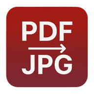
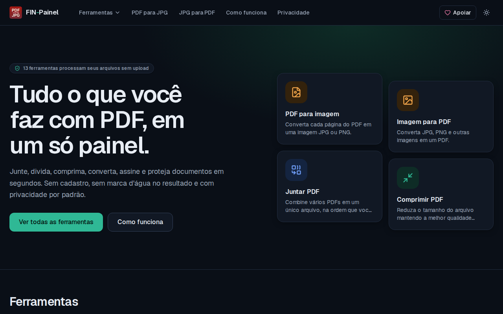
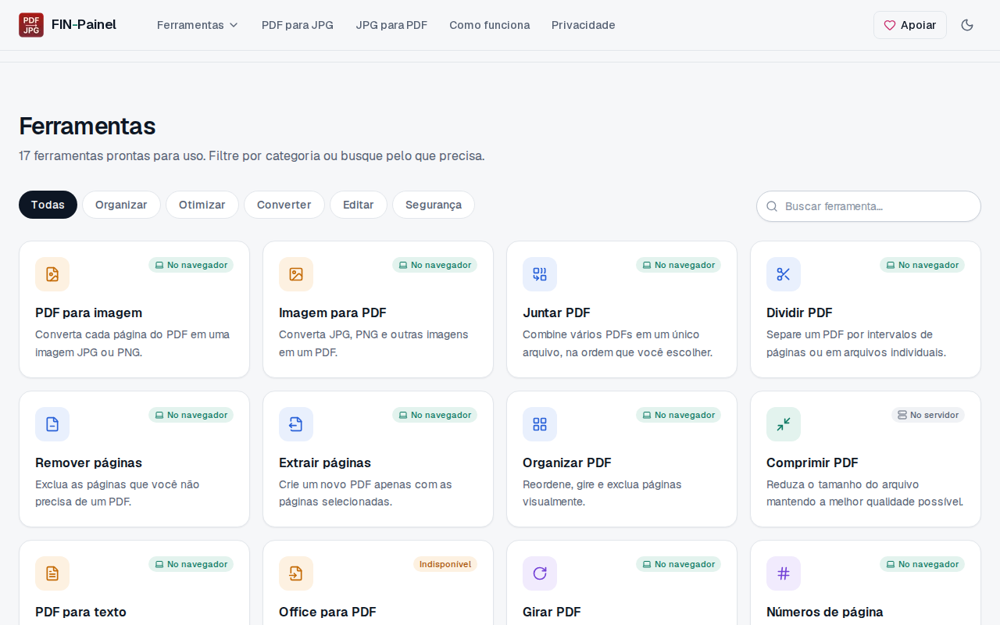
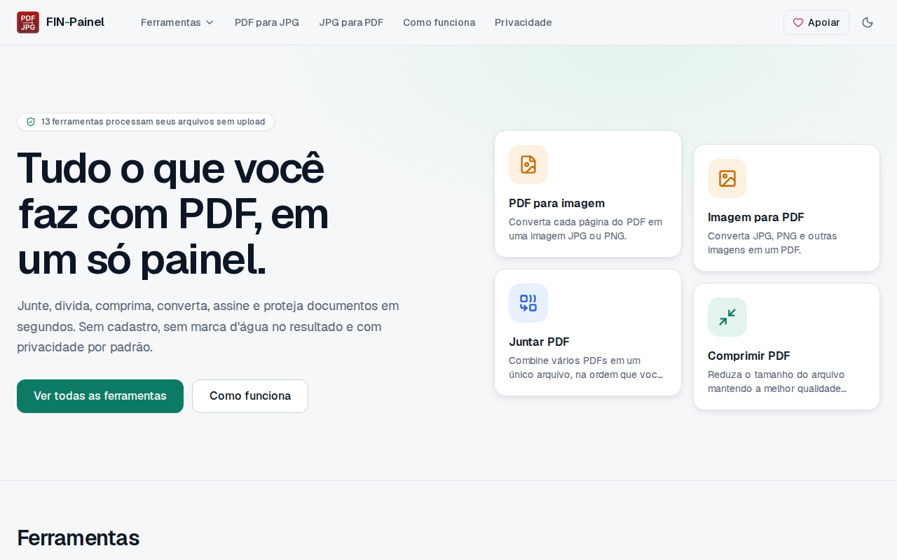
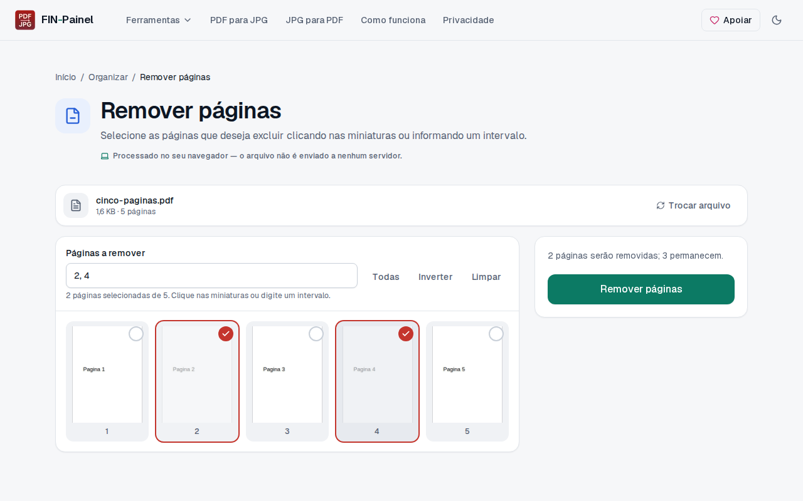
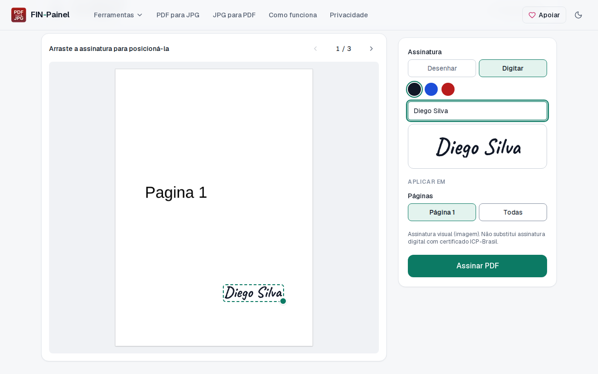
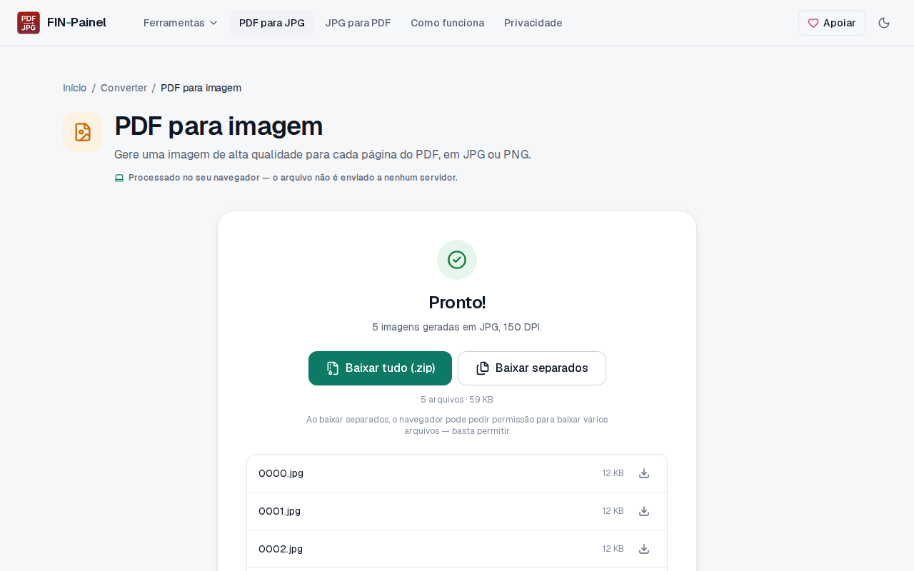
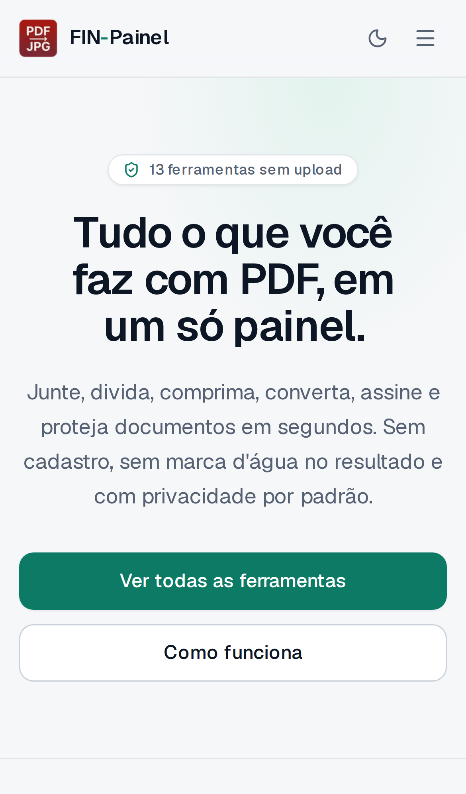

<div align="center">



# FIN-Painel

**Ferramentas de PDF gratuitas, de código aberto e com privacidade por padrão.**

Junte, divida, comprima, converta, assine e proteja documentos, com arquivos de até **950 MB**.

### 🌐 [pdfparajpg.netlify.app](https://pdfparajpg.netlify.app)

[](https://nextjs.org)
[](https://www.typescriptlang.org)
[](https://tailwindcss.com)
[](LICENSE)

[](#-testes)
[](#-ferramentas)
[](#-privacidade-por-padr%C3%A3o)

<br/>



</div>

---

## 💡 Por que este projeto existe

O FIN-Painel nasceu de uma necessidade real. Uma **igreja** lida diariamente com um volume muito alto de
documentos — atas, relatórios, certidões, comunicados, fotos de eventos e materiais digitalizados — e precisava
juntar, separar, converter e assinar PDFs o tempo todo, **com rapidez**.

As alternativas disponíveis eram, em sua maioria, **serviços pagos** ou planos gratuitos limitados. Além disso,
os arquivos da igreja costumam ser **enormes** (documentos escaneados em alta resolução) e esbarravam sempre nos
limites de tamanho desses serviços.

Por isso criei o FIN-Painel: uma **alternativa de código aberto**, gratuita, sem cadastro e sem anúncios.

- ✅ **Limite de 950 MB por arquivo**, pensado para documentos escaneados gigantes;
- ✅ **Os arquivos não saem do computador** na maioria das ferramentas — tudo é processado no próprio navegador;
- ✅ **Rápido**: sem filas nem espera por upload nas ferramentas locais;
- ✅ **Sem marca d'água** e sem limite de uso diário.

O código é aberto para que qualquer igreja, ONG, escola ou pessoa possa usar, hospedar e melhorar o projeto.

---

## 🧰 Ferramentas

| | Ferramenta | O que faz | Onde processa |
|:-:|---|---|:-:|
| 🖼️ | **PDF para JPG** | Cada página vira JPG ou PNG (72–300 DPI), numeradas `0000`, `0001`… e baixadas separadas ou em um `.zip` com a data do dia (ex.: `01 05 26.zip`) | 💻 Navegador |
| 📷 | **JPG para PDF** | JPG, PNG, WEBP, GIF e BMP em um PDF; corrige a rotação de fotos de celular | 💻 Navegador |
| 🔗 | **Juntar PDF** | Combina vários PDFs na ordem que você arrastar | 💻 Navegador |
| ✂️ | **Dividir PDF** | Por intervalos, a cada N páginas ou uma página por arquivo | 💻 Navegador |
| 🗑️ | **Remover páginas** | Exclui páginas clicando nas miniaturas ou digitando intervalos | 💻 Navegador |
| 📤 | **Extrair páginas** | Gera um PDF (ou um por página) só com as páginas escolhidas | 💻 Navegador |
| 🗂️ | **Organizar PDF** | Reordena (mouse, toque ou teclado), gira e exclui páginas | 💻 Navegador |
| 🔄 | **Girar PDF** | Gira todas ou só algumas páginas | 💻 Navegador |
| #️⃣ | **Números de página** | 6 posições, 4 formatos, número inicial e intervalo | 💻 Navegador |
| 💧 | **Marca d'água** | Texto centralizado ou em mosaico, com cor, opacidade e ângulo | 💻 Navegador |
| 🏷️ | **Editar metadados** | Título, autor, assunto e palavras-chave | 💻 Navegador |
| 📝 | **PDF para texto** | Extrai o texto selecionável para `.txt` | 💻 Navegador |
| ✍️ | **Assinar PDF** | Assinatura desenhada ou digitada, posicionada arrastando | 💻 Navegador |
| 🗜️ | **Comprimir PDF** | Três níveis de compressão | 🖥️ Servidor (Ghostscript) |
| 🔒 | **Proteger PDF** | Adiciona senha de abertura | 🖥️ Servidor (Ghostscript) |
| 🔓 | **Desbloquear PDF** | Remove a senha, informando a senha atual | 🖥️ Servidor (Ghostscript) |
| 📄 | **Office para PDF** | DOC, DOCX, ODT, RTF, XLS, XLSX, ODS, PPT, PPTX e ODP | 🖥️ Servidor (LibreOffice) |

> As ferramentas de servidor verificam em tempo real se o software necessário está instalado. Se não estiver,
> aparecem como **"Indisponível"**, com explicação — nunca como um botão que simplesmente falha.

---

## 📸 Capturas de tela

<table>
  <tr>
    <td width="50%"></td>
    <td width="50%"></td>
  </tr>
  <tr>
    <td align="center"><sub>Todas as ferramentas, com busca e filtro por categoria</sub></td>
    <td align="center"><sub>Tema claro, disponível pelo botão no cabeçalho</sub></td>
  </tr>
  <tr>
    <td></td>
    <td></td>
  </tr>
  <tr>
    <td align="center"><sub>Seleção visual de páginas</sub></td>
    <td align="center"><sub>Assinar PDF: desenhe ou digite e arraste até o lugar certo</sub></td>
  </tr>
  <tr>
    <td></td>
    <td align="center"></td>
  </tr>
  <tr>
    <td align="center"><sub>Download em <code>.zip</code> ou arquivos separados</sub></td>
    <td align="center"><sub>Totalmente responsivo no celular</sub></td>
  </tr>
</table>

---

## 🔐 Privacidade por padrão

- **13 das 17 ferramentas** usam [pdf-lib](https://pdf-lib.js.org) e [PDF.js](https://mozilla.github.io/pdf.js/)
  dentro do navegador: **o arquivo nunca é enviado pela rede**.
- Nas 4 ferramentas de servidor, o arquivo é gravado numa pasta temporária exclusiva e **apagado assim que a
  resposta é enviada** — inclusive em caso de erro.
- Sem cadastro, sem cookies de rastreamento e sem ferramentas de análise de terceiros.
- Todos os recursos (scripts, fontes e o worker do PDF.js) são servidos pela própria aplicação, sem CDN externa.

---

## 🚀 Executar localmente

**Requisitos:** Node.js 20.9 ou superior. Para as ferramentas de servidor: [Ghostscript](https://www.ghostscript.com)
(`gs`) e, opcionalmente, [LibreOffice](https://www.libreoffice.org) (`soffice`).

```bash
git clone https://github.com/thediegosilva/fin-painel.git
cd fin-painel
npm install
npm run dev        # abre em http://localhost:3000
```

<details>
<summary><b>Instalando o Ghostscript e o LibreOffice</b></summary>

```bash
# Ubuntu / Debian
sudo apt install ghostscript
sudo apt install libreoffice-writer libreoffice-calc libreoffice-impress   # opcional: Office → PDF

# macOS (Homebrew)
brew install ghostscript
brew install --cask libreoffice                                            # opcional
```

Sem eles, o site funciona normalmente — só as ferramentas que dependem deles aparecem como indisponíveis.
</details>

---

## 🧪 Testes

```bash
npm run lint           # ESLint
npm run typecheck      # TypeScript
npm test               # 42 testes unitários e de integração (Vitest)
npm run build          # build de produção
npx playwright install chromium   # apenas na primeira vez
npm run test:e2e       # 53 testes de ponta a ponta (Playwright), no desktop e no celular
npm run check          # lint + typecheck + testes + build, de uma vez
```

Os testes de ponta a ponta usam um navegador real: enviam arquivos, clicam em cada ferramenta e **conferem o
conteúdo dos arquivos baixados** — número de páginas, rotação, posição do texto, senha exigida, nomes dentro do
`.zip` etc. Também percorrem todos os links do site, checam o layout no celular e garantem que não há erros no
console.

---

## ☁️ Publicar

### Netlify — 13 ferramentas

O projeto já inclui o [`netlify.toml`](netlify.toml).

1. Em [app.netlify.com](https://app.netlify.com), clique em **Add new site → Import an existing project** e
   escolha este repositório;
2. Em **Site configuration → Site name**, use o nome desejado (a versão oficial usa `pdfparajpg`, que gera
   `https://pdfparajpg.netlify.app`);
3. Clique em **Deploy**.

O endereço público é definido em `NEXT_PUBLIC_SITE_URL` no [`netlify.toml`](netlify.toml). Se publicar com outro
nome ou domínio, altere esse valor.

As 13 ferramentas do navegador funcionam integralmente, inclusive com arquivos de 950 MB. A Netlify não oferece
Ghostscript nem LibreOffice, então **Comprimir, Proteger, Desbloquear e Office→PDF aparecem como indisponíveis**.

### Docker — todas as 17 ferramentas

A imagem já inclui o Ghostscript. Funciona em qualquer VPS ou em plataformas como Render, Railway e Fly.io.

```bash
docker build -t fin-painel .
docker build -t fin-painel --build-arg WITH_LIBREOFFICE=true .   # com Office → PDF (imagem maior)

docker run -d -p 3000:3000 \
  -e NEXT_PUBLIC_SITE_URL=https://pdf.seudominio.com.br \
  -e TRUST_PROXY=true \
  --name fin-painel fin-painel
```

A imagem roda como usuário sem privilégios e tem verificação de saúde em `/api/health`.

<details>
<summary><b>Servidor Node sem Docker (VPS)</b></summary>

```bash
npm ci && npm run build
cp -r public .next/standalone/ && cp -r .next/static .next/standalone/.next/
PORT=3000 NODE_ENV=production node .next/standalone/server.js
```

Coloque atrás de um proxy reverso com HTTPS (Nginx/Caddy), defina `TRUST_PROXY=true` e ajuste o limite de envio
do proxy (no Nginx: `client_max_body_size 1000m;` e `proxy_read_timeout 600s;`).
</details>

---

## ⚙️ Variáveis de ambiente

Todas são opcionais. Veja o [`.env.example`](.env.example).

| Variável | Padrão | Descrição |
|---|---|---|
| `NEXT_PUBLIC_SITE_URL` | `http://localhost:3000` | Endereço público (sitemap, robots e metadados) |
| `MAX_UPLOAD_MB` | `950` | Tamanho máximo por arquivo nas ferramentas de servidor. Reserve ~4× em RAM por processamento simultâneo (medido: ~3,7 GB para 900 MB) |
| `JOB_TIMEOUT_SECONDS` | `600` | Tempo máximo de cada processamento |
| `MAX_CONCURRENT_JOBS` | `2` | Processamentos simultâneos por instância (fila de até 4×) |
| `RATE_LIMIT_PER_MINUTE` | `20` | Requisições de processamento por minuto (`0` desativa) |
| `TRUST_PROXY` | `false` | `true` para limitar por IP via `X-Forwarded-For` (só atrás de proxy confiável) |
| `GHOSTSCRIPT_PATH` | `gs` | Caminho do Ghostscript |
| `LIBREOFFICE_PATH` | `soffice` | Caminho do LibreOffice |

---

## 🏗️ Arquitetura

```
src/
├── app/                     Rotas (Next.js App Router)
│   ├── [slug]/              Página de cada ferramenta (pré-renderizada; URL inexistente → 404 real)
│   ├── api/                 health · pdf/{compress,protect,unlock} · convert/office
│   ├── apoiar/              Página de apoio com QR Code Pix (gerado no build)
│   └── …                    como-funciona, privacidade, termos, status, sitemap, robots, manifest
├── components/
│   ├── layout/              Cabeçalho, rodapé, logo, contatos, tema claro/escuro
│   ├── ui/                  Design system: botões, alertas, campos, seletores
│   ├── tool/                Fluxo comum: upload, área de trabalho, resultado, miniaturas, arrastar-e-soltar
│   └── tools/               Uma implementação por ferramenta (carregada sob demanda)
├── hooks/                   Estado de processamento, seleção de arquivos, PDF.js
└── lib/
    ├── tools.ts             Registro único das ferramentas (menu, home, sitemap e testes)
    ├── pdf/                 Operações com pdf-lib (rodam no navegador e no Node)
    ├── client/              PDF.js, downloads/ZIP, upload com progresso
    ├── server/              Execução segura do Ghostscript/LibreOffice, limites e validação
    ├── pix.ts               Gerador do código Pix (padrão BR Code do Banco Central)
    └── author.ts            Dados de autoria e contatos
tests/
├── unit/                    Vitest
└── e2e/                     Playwright
```

**Destaques técnicos**

- **Carregamento sob demanda:** a página de uma ferramenta abre com ~180 KB de JavaScript; o pdf-lib só é baixado
  quando o usuário escolhe um arquivo.
- **Miniaturas eficientes:** renderizadas só quando aparecem na tela, com um único Web Worker compartilhado.
- **Páginas giradas tratadas corretamente:** números, marcas d'água e assinaturas ficam na posição visual certa
  em páginas com rotação de 0°, 90°, 180° ou 270° (coberto por testes).
- **Servidor seguro:** binários executados sem shell, com `-dSAFER`, tempo limite, pasta temporária exclusiva,
  fila de concorrência, limite de requisições e limite de tamanho aplicado durante a leitura do envio.
- **Cabeçalhos de segurança:** CSP restritiva, `X-Frame-Options: DENY`, `nosniff`, `Referrer-Policy` e
  `Permissions-Policy`.
- **Tema escuro por padrão:** o site abre escuro (já no HTML vindo do servidor, sem "piscar" claro); o tema
  claro fica disponível no botão do cabeçalho e a escolha é lembrada.
- **Acessibilidade:** navegação completa por teclado (inclusive para reordenar páginas), rótulos para leitores de
  tela e respeito à preferência por movimento reduzido.

**Tecnologias:** Next.js 16 · React 19 · TypeScript · Tailwind CSS 4 · pdf-lib · PDF.js 6 · dnd-kit · fflate ·
qrcode · Ghostscript · LibreOffice · Vitest · Playwright

---

## ⚠️ Limitações conhecidas

- **Assinatura visual:** o Assinar PDF insere uma imagem da assinatura; não é assinatura digital com
  certificado ICP-Brasil.
- **Proteger PDF:** usa RC4 de 128 bits (padrão do Ghostscript) — compatível com todos os leitores, porém mais
  fraco que AES-256.
- **Comprimir e Proteger reescrevem o PDF:** formulários interativos e assinaturas digitais existentes podem não
  ser preservados.
- **Sem OCR:** o PDF para texto extrai apenas texto selecionável.
- **Arquivos grandes:** acima de 300 MB, as ferramentas do navegador usam bastante memória (o site exibe um
  aviso); no celular, a aba pode ser encerrada pelo navegador.
- **Senha visível no servidor:** durante o processamento, a senha passada ao Ghostscript aparece na lista de
  processos do servidor. Hospede em container ou máquina dedicada.
- **Limites por instância:** o limite de requisições e a fila ficam em memória; com várias instâncias, use um
  limitador no proxy.

---

## 💚 Apoie o projeto

O FIN-Painel é e continuará sendo gratuito. Se ele te ajudou, contribua com **qualquer valor via Pix** pela
página **Apoiar** do site — há um QR Code e o código "Copia e Cola".

Contribuições de código também são muito bem-vindas: abra uma *issue* ou envie um *pull request*. Antes de enviar,
rode `npm run check` e `npm run test:e2e`.

---

## 👨‍💻 Autor

**Diego Silva** — Desenvolvedor Full-Stack · Rio de Janeiro, Brasil

<a href="https://github.com/thediegosilva"></a>
<a href="https://www.linkedin.com/in/thediegosilva"></a>
<a href="https://www.instagram.com/thediegosilva"></a>
<a href="mailto:thediegosilva@engineer.com"></a>
<a href="https://thediegosilva.github.io"></a>

---

## 📄 Licença

Distribuído sob a licença **MIT** — veja o arquivo [`LICENSE`](LICENSE). Você pode usar, copiar, modificar e
redistribuir livremente, desde que mantenha o aviso de copyright.

<div align="center">
<br/>
<sub>Feito com 💚 por <a href="https://github.com/thediegosilva">Diego Silva</a> — para quem precisa de PDFs sem complicação.</sub>
</div>
